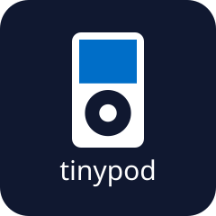
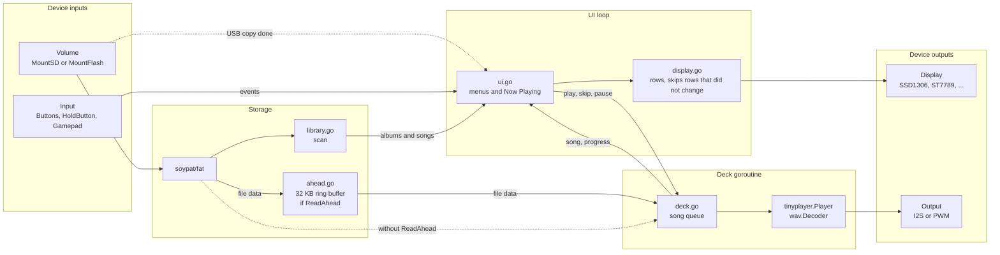

# tinypod



tinypod is an iPod classic style music player. It plays WAV files and shows Songs, Albums, Shuffle Songs and Now Playing menus.

tinypod uses [tinyplayer](https://github.com/hybridgroup/tinyplayer) to play the audio, and [TinyGo](https://tinygo.org) to run on microcontrollers.

The `tinypod` package at the root of this repo has no hardware code. It works with any display, songs on an SD card or in flash, and any set of buttons. A small main for each device sets up the hardware and calls `tinypod.Run`.

| Device | Folder | Display | Songs | Input | Audio |
|---|---|---|---|---|---|
| xiao-esp32c3 or xiao-rp2350 on the Seeed XIAO expansion board | `devices/xiao-expansion` | SSD1306 128x64 | microSD card | Gamepad QT, or the board button | I2S DAC |
| Pico 2 | `devices/pico2-ssd1306` | SSD1306 128x64 | flash, USB drive | 4 buttons | I2S DAC |
| Gopher badge | `devices/gopher-badge` | ST7789 320x240 color | flash, USB drive | 6 badge buttons | speaker |

## Build and flash

```
tinygo flash -tags fat_noexfat -target=xiao-rp2350 ./devices/xiao-expansion
tinygo flash -tags fat_noexfat -target=xiao-esp32c3 ./devices/xiao-expansion
tinygo flash -tags fat_noexfat -target=pico2 ./devices/pico2-ssd1306
tinygo flash -tags fat_noexfat -target=gopher-badge ./devices/gopher-badge
```

At start the screen shows "starting" and then "reading songs". The serial output shows the number of songs and albums. If something fails, the screen shows the error.

## Songs

Put WAV files in folders under `/Music`. Each folder is an album. Files in one level of subfolders are added to the album too. If there is no `/Music` folder, tinypod uses the root of the volume.

```
/Music/Album One/01 Song.wav
/Music/Album One/02 Song.wav
/Music/Album Two/Disc 1/01 Song.wav
/Music/Single.wav
```

The song name on the screen is the file name without `.wav`. The album name is the folder name.

Use ffmpeg to make the files. 16 bit PCM sounds best. IMA ADPCM files are 4 times smaller, which helps when songs are in flash.

```
ffmpeg -i in.mp3 -ac 2 -ar 44100 -c:a pcm_s16le out.wav
ffmpeg -i in.mp3 -ac 2 -ar 22050 -c:a adpcm_ima_wav out.wav
```

### SD card

Use a FAT32 microSD card of 4 GB to 32 GB (SDHC). tinypod mounts the card read only and never writes to it.

### Flash and USB drive

On boards with songs in flash, the board shows up as a USB drive named tinypod. The first time, tinypod formats the flash. Copy WAV files to the drive. One second after the copy ends, tinypod stops playback, reads the songs again and goes back to the main menu.

| Device | Flash | Space for songs | 22.05 kHz stereo ADPCM |
|---|---|---|---|
| Pico 2 | 4 MB | 3 MB | about 2.4 minutes |
| Gopher badge | 8 MB | 6 MB | about 4.8 minutes |

22.05 kHz stereo ADPCM uses about 22 KB per second. Mono ADPCM at 16 kHz uses 8 KB per second and gives about 6.5 and 13 minutes.

## Controls

The menus and Now Playing use these events. Each device maps its buttons to them.

| Event | Menus | Now Playing |
|---|---|---|
| Up, Down | Move | Volume |
| Left | Back | Previous song, or start of song after 3 seconds |
| Right | Open | Next song |
| Select | Open | Play/pause |
| Back | Back | Back to menus |
| PlayPause | Play/pause | Play/pause |
| VolumeUp, VolumeDown | Volume | Volume |
| Next, Previous | Next or previous song | Next or previous song |

If nothing is playing, PlayPause plays all songs from the start.

## xiao-expansion

Folder `devices/xiao-expansion`.

A xiao-esp32c3 or xiao-rp2350 plugged into the [Seeed XIAO expansion board](https://wiki.seeedstudio.com/Seeeduino-XIAO-Expansion-Board/). The expansion board has the microSD slot, the OLED, a button and a buzzer. You connect the DAC and the gamepad.

Parts:

- xiao-esp32c3 or xiao-rp2350
- Seeed XIAO expansion board
- An I2S DAC such as the Adafruit PCM5102, with headphones or a powered speaker
- Optional: an [Adafruit Mini I2C Gamepad QT](https://www.adafruit.com/product/5743) and a Grove to STEMMA QT cable
- A microSD card, see [SD card](#sd-card)

The expansion board uses D1 for the button, D2 and D8 to D10 for the SD card, D3 for the buzzer, and D4/D5 for I2C. The DAC uses the free pins D0, D6 and D7. Use jumper wires from the expansion board pin headers.

| DAC pin | XIAO pin | xiao-esp32c3 | xiao-rp2350 |
|---|---|---|---|
| VIN | 3V3 | | |
| GND | GND | | |
| BCK | D6 | GPIO21 | GPIO0 |
| WSEL (LCK) | D7 | GPIO20 | GPIO1 |
| DIN | D0 | GPIO2 | GPIO26 |

On the RP2350 the WSEL pin must be the pin after BCK, because of how the PIO I2S program works. See [AUDIO.md in tinyplayer](https://github.com/hybridgroup/tinyplayer/blob/main/AUDIO.md) for the extra pins that some PCM5102 boards have.

Plug the gamepad into the Grove I2C port. It shares the bus with the OLED. The gamepad uses address 0x50 and the OLED uses 0x3C.

With the gamepad:

| Control | Event |
|---|---|
| Joystick | Up, Down, Left, Right |
| A | Select |
| B, Select | Back |
| Start | PlayPause |
| X, Y | VolumeUp, VolumeDown |
| Expansion board button | Back |

With no gamepad, the expansion board button does everything. It acts when you release it.

| Press | Event |
|---|---|
| Tap | Down |
| Hold 0.5 seconds | Select |
| Hold 1.5 seconds | Back |

tinypod looks for the gamepad only at start. To change from one input to the other, reset the board.

## pico2-ssd1306

Folder `devices/pico2-ssd1306`.

A Pico 2 with an SSD1306 OLED, four buttons and an I2S DAC. Songs are in flash, which shows up as a USB drive. Power and flashing use the Pico 2 USB port.

Parts:

- Raspberry Pi Pico 2
- SSD1306 128x64 I2C OLED at address 0x3C
- 4 push buttons
- An I2S DAC such as the Adafruit PCM5102, with headphones or a powered speaker

The physical pin is the Pico 2 header pin. Pin 1 is next to the USB port on the left side.

OLED on I2C1:

| OLED pin | Pico 2 | Physical pin |
|---|---|---|
| VCC | 3V3(OUT) | 36 |
| GND | GND | 8 |
| SDA | GPIO6 | 9 |
| SCL | GPIO7 | 10 |

Most OLED modules have pull up resistors for I2C. If yours uses address 0x3D, change the address in `NewSSD1306` in `main.go`.

DAC:

| DAC pin | Pico 2 | Physical pin |
|---|---|---|
| VIN | 3V3(OUT) | 36 |
| GND | GND | 3 |
| DIN | GPIO2 | 4 |
| BCK | GPIO3 | 5 |
| WSEL (LCK) | GPIO4 | 6 |

WSEL must be the pin after BCK, because of how the PIO I2S program works. If your DAC board has more pins than the Adafruit one, connect SCK to GND, XSMT to 3V3, and FMT, FLT and DEMP to GND. See [AUDIO.md in tinyplayer](https://github.com/hybridgroup/tinyplayer/blob/main/AUDIO.md).

Buttons. Connect one leg of each button to its pin and the other leg to GND. The pins use the internal pull up, so no resistors are necessary.

| Button | Pico 2 | Physical pin | GND near it |
|---|---|---|---|
| Up | GPIO10 | 14 | 13 |
| Down | GPIO11 | 15 | 13 or 18 |
| Select | GPIO12 | 16 | 18 |
| Back | GPIO13 | 17 | 18 |

| Button | Press | Hold 0.5 seconds |
|---|---|---|
| Up | Up, repeats while held | |
| Down | Down, repeats while held | |
| Select | Select | PlayPause |
| Back | Back | Next |

The I2C pins are not the default GPIO4 and GPIO5, because GPIO4 is the I2S WSEL pin.

If the computer does not see the Pico 2 at all, hold BOOTSEL while you plug in the USB cable. A drive named RP2350 shows up and `tinygo flash` can write to it.

## gopher-badge

Folder `devices/gopher-badge`.

The gopher badge needs no wiring. tinypod uses the 320x240 color screen, the six buttons and the speaker.

| Button | Press | Hold 0.5 seconds |
|---|---|---|
| Up | Up, repeats while held | |
| Down | Down, repeats while held | |
| Left | Left | |
| Right | Right | |
| A | Select | PlayPause |
| B | Back | |

The speaker plays mono audio through the `pwm` package.

## Add a device

Write a main that sets up the hardware and fills a `tinypod.Config`:

```go
err := tinypod.Run(tinypod.Config{
	Display: disp,                // any driver with Size, SetPixel and Display
	Theme:   tinypod.MonoTheme(), // or ColorTheme, or your own font and colors
	Output:  out,                 // I2S or pwm.PWM
	Volume:  vol,                 // from MountSD or MountFlash
	Input: tinypod.Buttons(
		tinypod.Button{Pressed: up, Press: tinypod.Up, Repeat: true},
		tinypod.Button{Pressed: sel, Press: tinypod.Select, Hold: tinypod.PlayPause},
	),
})
```

- Display: tinypod uses `FillRectangle` too if the driver has it. For an SSD1306 on I2C use `tinypod.NewSSD1306`, see [Screen](#screen).
- Theme: the layout comes from the display size and the font. `MonoTheme` uses an 8 point font for small screens. `ColorTheme` uses Noto Sans 12 point.
- Volume: `MountSD` needs the SPI bus at 400 kHz and a function that raises the clock after setup. `MountFlash` takes a tinyplayer `flashdisk.Disk`. Call `msc.Port(disk)` before `machine.USBDev.Configure` so it shows up as a USB drive.
- Input: `Buttons` for buttons, `HoldButton` for one button, `Gamepad` for the Gamepad QT with a `GamepadMap`, and `Inputs` to use several at once. `Pressed` is a function, so a button can come from a pin, an I/O expander or a touch pad.
- ReadAhead: set it if the display or the storage holds the CPU for long, as on the ESP32-C3. See [Read ahead](#read-ahead).

## How it works

tinypod has two main goroutines. The UI loop reads the input and draws the screen. The deck goroutine plays songs. With ReadAhead a third goroutine reads songs ahead. The arrows show the direction of the data. The device main sets up the boxes on the left and right.



### Start

The device main sets up the display, the audio output, the volume and the input. `Run` scans the songs, starts the deck goroutine and runs the UI loop.

### Storage

`MountSD` uses the `sd` package from [tinygo.org/x/drivers](https://github.com/tinygo-org/drivers). The card starts at 400 kHz, because the SD specification requires a slow clock during setup. Then the device raises the SPI clock. `sd.SPICard` has the block methods that [github.com/soypat/fat](https://github.com/soypat/fat) needs, so the FAT volume mounts on it with no adapter.

`MountFlash` uses the tinyplayer `storage.Mount` on a tinyplayer `flashdisk.Disk`. The UI loop watches the disk change counter. When the USB host stops writing for one second, tinypod stops the deck, writes the flash cache, mounts the volume again and scans the songs.

### Music library

`library.go` reads the folders and keeps a list of albums and a sorted list of all songs. Each song is a full path on the volume.

### Playback

`deck.go` plays a queue of songs in its own goroutine. It opens each file and gives it to `tinyplayer.Player`, which decodes the WAV data and writes it to the output. When a song ends, the deck plays the next one.

The UI asks for a new song with `play` or `skip`. These set the next position and a cut flag, then call `Player.Stop`. The deck reads the file through its own `Read` method, which returns end of file when the cut flag is set. Thus a song always ends when you ask, even if `Stop` comes before `Play` starts. Pause uses `Player.Pause`, and the time bar uses `Player.Progress`.

### Read ahead

With ReadAhead, `ahead.go` reads each song into a 32 KB ring buffer in a separate goroutine, and the player decodes from this buffer. The ESP32-C3 I2S output holds only about 9 ms of audio at 44.1 kHz, and SD reads and screen updates can take longer. The buffer holds about 190 ms, so these delays do not stop the audio.

Leave ReadAhead off with piolib I2S on the RP2040 and RP2350. piolib I2S starts one DMA buffer at a time, and SPI transfers in the read ahead goroutine do not yield. The next audio buffer then starts late and the audio clicks.

### Screen

`display.go` splits the screen into rows. Row 0 is the title bar, and the other rows have the height of the font. `ui.go` keeps a stack of menus and draws the top one, or the Now Playing screen.

Each row has a key, made from what it shows. A row is drawn again only when its key changes, and then its background is filled before the text. Thus on Now Playing only the time bar and the time change each second. This matters on displays like the ST7789, where each pixel is a separate SPI write. On buffered displays like the SSD1306, `Display` sends the frame only if a row changed.

The UI loop runs every 30 ms. It reads the input and draws only when something changes.

On the ESP32-C3 an I2C write holds the CPU until it is done. A full SSD1306 frame is 1 KB and takes about 30 ms at 400 kHz. `tinypod.NewSSD1306` sends the frame in 32 byte pieces and yields after each piece, so audio playback can continue.

### Input

`Buttons` reads each button every 30 ms. A button with Hold fires Press on a short press and Hold after 500 ms. A button with Repeat fires again after 400 ms and then every 120 ms. `Gamepad` reads the seesaw chip on the Gamepad QT, the buttons as one 32 bit value and the joystick from two ADC channels.

## Files

| File | What it does |
|---|---|
| `tinypod.go` | `Config`, `Run`, `Fail` |
| `display.go` | `Display`, `Theme`, rows and `Message` |
| `ssd1306.go` | SSD1306 that sends the frame in pieces |
| `ui.go` | Menus and Now Playing |
| `input.go` | `Buttons`, `HoldButton`, `Gamepad`, `Inputs` |
| `storage.go` | `MountSD`, `MountFlash` and the USB copy watch |
| `library.go` | Album and song scan |
| `deck.go` | Playback goroutine and song queue |
| `ahead.go` | Read ahead ring buffer |
| `devices/xiao-expansion`, `devices/pico2-ssd1306`, `devices/gopher-badge` | Device mains |

`make test` runs the tests on your computer, with a FAT volume in memory and a fake display. `make smoketest` builds every device with TinyGo.

## Known issues

- tinypod on an SD card needs the `sd` fix in [tinygo-org/drivers#905](https://github.com/tinygo-org/drivers/pull/905). Without it, the SD card does not mount.
- On the RP2350 with piolib I2S and SPI it needs [tinygo-org/pio#65](https://github.com/tinygo-org/pio/pull/65). Without it, piolib I2S and SPI0 use the same DMA channel, and the board stops when a song starts.
- `go.mod` uses the branches of these two PRs until they are merged.
- The `sd` package reads several blocks at a time correctly only on SDHC cards. Do not use cards of 2 GB or less.
- Cards of 64 GB or more usually come formatted as exFAT. Format them as FAT32.
- The ColorTheme font is Noto Sans from tinyfont, under the SIL Open Font License.

## License

Apache 2.0, see [LICENSE](LICENSE).
